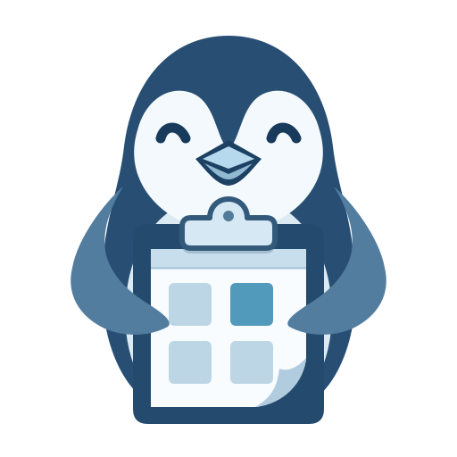
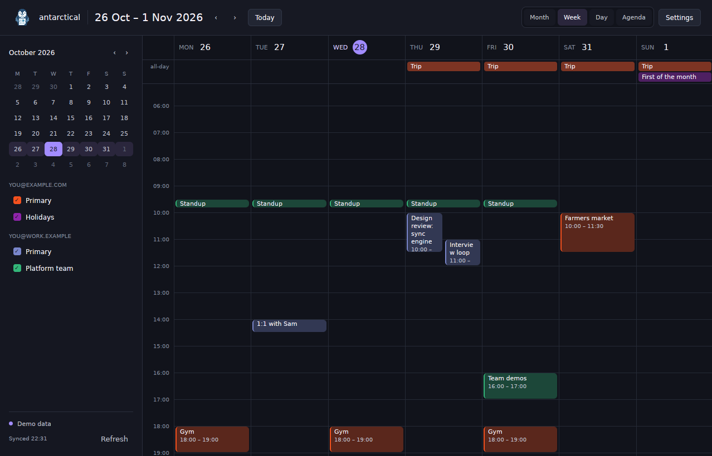

# Antarctical

A native Google Calendar viewer for Linux, built with Rust and [GPUI](https://www.gpui.rs/). Bring personal and work calendars into one window, check your next meeting from the tray, and get reminders on your desktop.

[Website](https://antarctical.korora.tech) · [Screenshots](https://antarctical.korora.tech/#screenshots) · [Google setup](docs/google-calendar.md) · [Report a bug](https://github.com/korora-tech/antarctical/issues) · [Apache 2.0](LICENSE)

> [!IMPORTANT]
> **Google Calendar integration is currently limited to approved testers.** To use the built-in integration, email [david@rawkode.academy](mailto:david@rawkode.academy?subject=Antarctical%20tester%20access) with the Google account address you want to connect and ask to be added. **Demo mode is available to everyone**, without Google sign-in.



*A real app capture using generated demo data. See [month, day and agenda views](https://antarctical.korora.tech/#screenshots) on the website.*

## What it does

- **Multiple Google accounts:** bring calendars together and hide or show each one from the sidebar.
- **Four views:** month, week, day and agenda, with keyboard shortcuts and a mini calendar for navigation.
- **A fixed penguin tray icon:** open a compact calendar and agenda. The icon never shows a date badge.
- **Desktop reminders:** use Google Calendar's popup reminders. Hidden calendars and declined events never notify.
- **Meeting details:** see guests, location and description, join a video call, or open the event in Google Calendar.
- **Automatic sync:** refresh every five minutes, refresh manually, and retry temporary network failures.
- **Local credential storage:** refresh tokens stay in your system keyring; calendar data stays in memory. No app analytics or telemetry.
- **Linux desktop integration:** Wayland and X11, Nix packages, Home Manager autostart, and an optional Dux next-event widget.

**Current limits:** Antarctical is a viewer. Creating or editing events and replying to invitations are not implemented. There is no persistent offline cache, so calendars are fetched again at startup. The Google consent screen currently requests full calendar access in preparation for editing support; the app only reads calendars today.

## Try it without a Google account

On a Linux desktop with [Nix](https://nixos.org/download/) and flakes enabled:

```sh
nix run github:korora-tech/antarctical -- --demo
```

Demo mode generates accounts and events for all four views. It does not connect to Google, save preferences, or expose generated events to Dux. It can run alongside your signed-in instance.

## Install and run

Nix packages are provided for `x86_64-linux` and `aarch64-linux`.

```sh
# Launch without adding it to your profile
nix run github:korora-tech/antarctical

# Install, then launch from your terminal or desktop application menu
nix profile add github:korora-tech/antarctical
antarctical
```

On older Nix versions, use `nix profile install` in place of `nix profile add`. If Nix asks you to enable experimental features, add `experimental-features = nix-command flakes` to `~/.config/nix/nix.conf`.

Your desktop needs:

- A Wayland or X11 session and working Vulkan support for GPUI rendering.
- An unlocked [Secret Service](https://specifications.freedesktop.org/secret-service-spec/latest/) keyring for Google sign-in, such as GNOME Keyring, KWallet or KeePassXC with its Secret Service integration enabled.
- A StatusNotifierItem host for the tray, such as KDE, a compatible desktop bar, or GNOME with an AppIndicator extension. Without one, Antarctical runs without a tray and exits when its window closes.

### Connect your calendars

1. [Request tester access](mailto:david@rawkode.academy?subject=Antarctical%20tester%20access) and wait for confirmation for the Google account you intend to use.
2. Open Antarctical and choose **Sign in with Google**. Complete consent in your browser, then return to the app.
3. To connect another approved account, open **Settings → Google accounts → Add another account**.

You can also configure your own Google Desktop OAuth client in Settings. See the [Google Calendar guide](docs/google-calendar.md) for instructions, testing-mode sign-in expiry, credential storage and sync behaviour.

### Start with your desktop

`antarctical --hidden` starts the app in the tray. The [Home Manager module](docs/desktop-integration.md#home-manager) can install it and run it as a systemd user service. The same guide covers the [Dux calendar backend](docs/desktop-integration.md#dux-calendar-backend) and [next-event widget](docs/desktop-integration.md#next-event-bar-widget).

## Keyboard shortcuts

| Key | Action |
| --- | --- |
| `T` | Go to today |
| `←` / `→` or `H` / `L` | Previous / next period |
| `M` / `W` / `D` / `A` | Month / week / day / agenda |
| `Esc` | Close event details or leave Settings |
| `Ctrl+,` | Open Settings |
| `Ctrl+R` | Refresh calendars |
| `Ctrl+W` | Close the window; keep running if the tray is available |
| `Ctrl+Q` | Quit |

## Troubleshooting

| Problem | What to check |
| --- | --- |
| Google blocks sign-in | The exact Google account must be on the tester list for the built-in client. [Request access by email](mailto:david@rawkode.academy?subject=Antarctical%20tester%20access). |
| Google asks you to sign in again | Testing-mode calendar authorizations expire after seven days. [Details](docs/google-calendar.md#request-tester-access). |
| Keyring is locked or unavailable | Start or unlock your Secret Service provider, then select **Retry** or press `Ctrl+R`. |
| No tray icon | Check that your desktop has a StatusNotifierItem host. |
| App reopens after quitting | The Home Manager service restarts it. Run `systemctl --user stop antarctical` to keep it closed for the session. |

For calendar visibility, declined events, preferences and single-instance behaviour, see [desktop integration](docs/desktop-integration.md#everyday-use). For refresh and reminder rules, see [sync](docs/google-calendar.md#sync) and [reminders](docs/google-calendar.md#reminders).

## Development

```sh
git clone https://github.com/korora-tech/antarctical.git
cd antarctical
nix develop -c cargo run -- --demo
```

The Nix development shell supplies Rust and the native build dependencies. Run the app normally with `nix develop -c cargo run --release`, or build the packaged application with `nix build`.

```sh
nix develop -c cargo fmt --check
nix develop -c cargo clippy --all-targets -- -D warnings
nix develop -c cargo test
nix flake check
```

The Astro website lives in `website/` and deploys to Cloudflare Workers. With [Bun](https://bun.sh/) installed:

```sh
cd website
bun install --frozen-lockfile
bun run dev
bun run build
```

| Location | Purpose |
| --- | --- |
| `src/ui/` | GPUI calendar views, event details, settings and tray window |
| `src/google/`, `src/secrets.rs`, `src/sync.rs` | Google API, OAuth, keyring storage and sync |
| `src/demo.rs` | Generated demo calendars and events |
| `src/tray.rs`, `src/reminders.rs`, `src/dankcal.rs` | Desktop tray, notifications and Dux socket |
| `data/branding/`, `src/branding.rs` | Shared penguin artwork and embedded app assets |
| `dux-plugin/`, `nix/hm-module.nix` | Dux widget and Home Manager module |
| `website/` | Website, legal pages and real demo screenshots |

Bug reports should include your desktop environment, Wayland or X11, how you installed the app, and steps to reproduce. Demo mode is useful for sharing a screenshot without exposing your calendar.

## License

Antarctical's code, documentation and original artwork are licensed under the [Apache License, Version 2.0](LICENSE). Third-party dependencies retain their own licenses.
